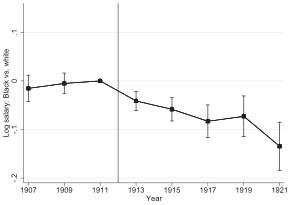
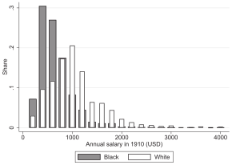
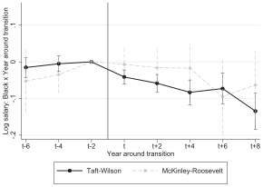
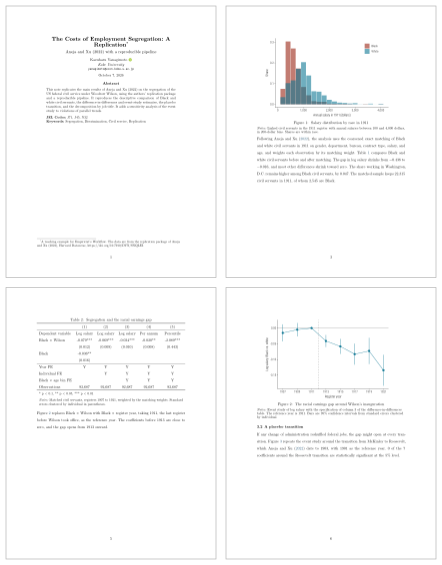

---
# A three-hour workshop deck covering the textbook's sections 11.1 and 11.3
# (lesson/targets.qmd) and chapter 12 (lesson/ai.qmd).
#
# Render with `quarto render index.qmd` from this folder. Almost every slide is
# an animated diagram: a function in typst/*.typ that redraws the picture for
# each subslide, called as `#slide(repeat: n, self => anim-x(self.subslide))`.
# Add `handout: true` below for a PDF with one page per slide (the last frame).
title: "AIによる研究パイプライン"
subtitle: "{targets} と Quarto で, 確かめながら進める"
brand:
  typography:
    fonts:
      - family: Noto Sans JP
        source: system
      - family: Fira Code
        source: system
    base:
      family: Noto Sans JP
    headings:
      family: Noto Sans JP
    monospace:
      family: Fira Code
format:
  touying-typst:
    include-in-header:
      text: |
        #import "@preview/touying-quarto-clean:0.2.0": *
        #import "typst/lib.typ": *
        #import "typst/intro.typ": *
        #import "typst/targets.typ": *
        #import "typst/quarto.typ": *
        #import "typst/reading.typ": *
        #import "typst/workflow.typ": *
        #import "typst/cleanroom.typ": *
        // Numbers measured by R (written by the `values` chunk below).
        #let deck-values = json("output/values.json")
        #let q = deck-values.q
        #let ax = deck-values.ax
        #let deck-theme = clean-theme.with(
          font-family-heading: brand-font-heading,
          font-family-body: brand-font-body,
          font-weight-heading: "medium",
          font-weight-body: "regular",
          font-weight-title: "medium",
          font-weight-subtitle: "regular",
          config-common(new-section-slide-fn: deck-section-slide),
        )
    theme-typst: deck-theme
environments:
  exercise: exercise
  prompt: prompt-card
author:
  - name: 柳本和春
    orcid: 0009-0007-1967-8304
    email: yanagimoto@econ.kobe-u.ac.jp
    affiliations: 神戸大学
date: today
date-format: long
---

```{r}
#| label: setup
#| include: false
# Self-contained: source this deck's frozen setup, never tar_load() a pipeline.
source("code/setup.R")
theme_set(theme_slide())
```

```{r}
#| label: values
#| include: false
# Hand the measured numbers to the Typst diagrams through a file, so that no
# result is typed into a figure by hand. The header of this deck reads
# output/values.json: `q` holds the Quarto + targets example, `ax` the
# replication of Aneja and Xu (2022).
q_row <- function(name) {
  r <- quarto_example |> filter(scenario == name)
  list(
    completed = as.character(r$completed),
    skipped = as.character(r$skipped),
    est = sprintf("%.2f", r$estimate)
  )
}
values <- list(
  q = list(
    base = q_row("base"),
    theme = q_row("theme"),
    event = q_row("event"),
    clean = q_row("clean")
  ),
  ax = list(
    n_matched = fmt_int(sample_sizes$n_matched),
    n_singletons = fmt_int(sample_sizes$n_singletons),
    n_estimation = fmt_int(sample_sizes$n_estimation),
    did3 = fmt_num(did3$estimate),
    did3_se = fmt_num(did3$std_error),
    did3_pub = fmt_num(did3$published_estimate),
    tab3_col2 = fmt_num(published_tab3_col2$estimate),
    tab3_col2_se = fmt_num(published_tab3_col2$std_error),
    bd_first_last = as.character(bd_first$last_robust),
    bd_first_zero = as.character(bd_first$first_zero),
    bd_avg_zero = as.character(bd_avg$first_zero)
  )
)
dir.create("output", showWarnings = FALSE)
jsonlite::write_json(
  values,
  "output/values.json",
  auto_unbox = TRUE,
  pretty = TRUE
)
```

## AIと研究コスト

```{=typst}
#anim-cost()
```

- AI なら数百行のコードも数分で書けるが, 確かめるコストは変わらない.
- AI が速く書くほど, 確かめる仕事の比重が増していく.

## ツールと検証性

```{=typst}
#anim-four-tools()
```



- AI時代は, 検証のしやすさをツールとワークフローで整備する必要がある

# `{targets}` の基本

## スクリプトを順に実行するやり方は, 変更に弱い

```{=typst}
#slide(repeat: 3, self => anim-scripts(self.subslide))
```

## パイプラインを構成する3つの要素

```{=typst}
#anim-elements()
```

- ファイルを読んでオブジェクトを作り, 関数に通して次のオブジェクトを作る.

## パイプライン

```{=typst}
#slide(repeat: 5, self => anim-build(self.subslide))
```

## パイプラインの実行

```{=typst}
#slide(repeat: 6, self => anim-make(self.subslide))
```

## 演習1: パイプラインを組む

:::: {.exercise options="num: 1, time: 10"}

[11.1 節](https://kazuyanagimoto.com/workshop-graduate-2026/lesson/targets.html) のコードで, 種ごとのくちばしの平均長を計算せよ.




1. 空のフォルダに, R ファイル2つと生データの CSV を用意する.
1. 実行前のグラフを見てから計算し, もう一度グラフを見る.
1. `penguins_summary` を読み出し, 結果を確かめる.

   ```r
   targets::tar_visnetwork()
   targets::tar_make()
   targets::tar_read(penguins_summary)
   ```

::::

## 演習2: パイプラインと変更 {#sec-exr-2}

:::: {.exercise options="num: 2, time: 10"}

次の変更を入れた時の各挙動を `tar_visnetwork()` や `tar_make()` で確かめよ.



1. `clean_penguins()` で, 体重が欠損した個体も除く.

   ```r
   filter(!is.na(bill_len), !is.na(body_mass))
   ```

1. R コンソールで, 2008 年以降の生データを CSV に上書きする.

   ```r
   write.csv(subset(penguins, year >= 2008),
             "data/penguins.csv", row.names = FALSE)
   ```

[[解説]{.button}](#sec-ans-2_1)

::::


## 覚えておくべき4つのコマンド

```{=typst}
#fig-commands()
```

# Quarto + `{targets}`

## Quarto とパイプライン

```{=typst}
#anim-qpipe-overview()
```

- `tar_data` でデータを整え, `tar_analysis` で集計・推定する.
- `tar_manuscript` で原稿を PDF にし, `_targets.R` で3つを束ねる.

## Quarto と図表

```{=typst}
#anim-compute-render()
```

- Quarto では, `tar_load()` で読み込んだオブジェクトから図や表を作ることを推奨

## オブジェクトと読み込み

```{=typst}
#slide(repeat: 4, self => anim-manuscript(self.subslide, q))
```

## `tar_quarto()` による依存関係の自動生成

```{=typst}
#anim-tar-quarto()
```

- `main.qmd` の変更も, 読み込んでいるオブジェクトの変更も自動で追跡される

## インラインコード

```{=typst}
#slide(repeat: 2, self => anim-inline(self.subslide, q))
```


## 演習3: Quarto + `{targets}` で PDF を作る {#sec-exr-3}

:::: {.exercise options="num: 3, time: 15"}

[教材 ZIP](https://kazuyanagimoto.com/workshop-graduate-2026/static/data/targets-quarto.zip) を展開し, `targets::tar_make()` で PDF を作ってください.
次を順に試し, 毎回, 再計算の個数を予想してから実行します.



1. `manuscript/main.qmd` のテーマを `theme_minimal` にする.
1. `R/tar_analysis.R` の `estimate_event()` の式から `x1` を外す.
1. `R/tar_data.R` の `clean_did()` の末尾に, 次の条件を足す.

   ```r
   |> filter(abs(x1) < 8)
   ```

[[解説]{.button}](#sec-ans-3)

::::


# AIと文献を読む

## 題材: 人種分離は, 黒人公務員の賃金をどう変えたか

:::: {.columns}
::: {.column width="50%"}
{width="100%"}

[@aneja2022, Figure II]{.small-cite}
:::
::: {.column width="50%"}
- 1913 年に発足した Wilson 政権が, 連邦政府の公務員を人種で分離した
- 1907 年から 1921 年の職員名簿をデジタル化し, 1910 年のセンサスと接続して人種を特定
- 黒人と白人の賃金差が, 政権交代の前後でどう変わったかを推定
- Replication package が公開されていて (CC0), 主要な分析を手元で再現できる
:::
::::

## Git: 頼む前にコミットすれば, 変更はすべて見える

```{=typst}
#slide(repeat: 5, self => anim-git(self.subslide))
```

## 頼む作業の単位を, コミットの単位に揃える

```{=typst}
#slide(repeat: 3, self => anim-ask-size(self.subslide))
```

## Zotero: DOI の照合が, ハルシネーションの検査になる

```{=typst}
#slide(repeat: 6, self => anim-zotero(self.subslide))
```

## 文献を整理させる指示を書く

:::: {.exercise options="num: 4, time: 8"}

研究への貢献を説明するために, AI への指示を2つ書いてください.

1. 文献の流れを整理させる. 対象の範囲と, 各論文で挙げる情報を指定する.
1. Zotero の `wilson-segregation` の全文を使い, 整理を書き直させる.

```{=typst}
#exercise-note([書けたら], [隣の人と見せ合い, 自分の指示にない点を探す.])
```

::::

## プロンプト例: 確かめる手順を, 指示の中に作っておく

::: {.prompt}
Wilson 政権による公務員の人種分離が, 黒人公務員の賃金に与えた影響を調べたい. この研究が貢献しうる経済学の文献の流れを3つ挙げて. それぞれについて代表的な論文を5本ずつ, [著者, 年, 雑誌, DOI 付き]{.alert} で挙げること. 対象は査読付き論文と, NBER などのワーキングペーパーに限る. 各流れで [何が分かっていて, 何が分かっていないか]{.alert} も, 1段落ずつまとめて.
:::

::: {.prompt}
Zotero の `wilson-segregation` コレクションにある論文を [全文で読んで]{.alert}, さっきの3つの流れに分類して. 各論文が何を問い, どのデータと識別戦略で, 何を示したかを2, 3文でまとめ, [根拠のページ番号]{.alert} を付けて. 最初の整理と食い違う点があれば, [全文の方を正として]{.alert} 直すこと.
:::

DOI は次の照合で使います. 「まだ誰も答えていない」かどうかは, 手元のライブラリの範囲でしか言えません.

## 精読: ページ番号と「記載なし」を答えさせる

```{=typst}
#slide(repeat: 3, self => anim-close-reading(self.subslide))
```

## Replication package で, AI の読みを検算する

```{=typst}
#slide(repeat: 4, self => anim-singleton(self.subslide, ax))
```

# 研究のワークフロー

## 研究は, 2周の試行錯誤とフィードバックで進む

```{=typst}
#slide(repeat: 5, self => anim-rounds(self.subslide))
```

## ノートとスライドは凍結し, 論文だけがパイプラインを読む

```{=typst}
#slide(repeat: 4, self => anim-frozen-live(self.subslide))
```

## ノートは, 意図を読んでから指示を書いて作る

```{=typst}
#slide(repeat: 4, self => anim-intent-prompt(self.subslide))
```

## `01-descriptive`: 分布が重ならないので, マッチングが要る

:::: {.columns}
::: {.column width="52%"}
{width="100%"}

[@aneja2022, Figure I]{.small-cite}
:::
::: {.column width="48%"}
- 黒人の賃金は, 分布全体で低い
- 多くの黒人と白人の賃金が重ならない
- そこで, 1911 年の時点で性別, 部局, 契約の形態, 賃金, 年齢が近い黒人と白人を組にする (coarsened exact matching)
:::
::::

## `02-did`: 推定式のほかにも, 決めることがある

```{=typst}
#v(0.6em)
#fig-did-eq()
#v(0.8em)
```

- 主な推定値は, これに黒人 × 年齢階級の固定効果を加えたもの. 効果を小さめに見積もる, 保守的な定式化
- イベントスタディは, $\text{Black}_i \times \text{Wilson}_t$ を名簿の年ごとの係数に置き換える
- サンプル, ウェイト, 標準誤差, 基準年は, 式には現れない. AI に頼むには, これも決める必要がある

## Table II と Figure II を推定する指示を書く

:::: {.exercise options="num: 5, time: 10"}

`notes/02-did/` で, 表の5列とイベントスタディを推定する指示を書いてください.

```{=typst}
#spec-table(highlight: true, size: 15.5pt, striped: false)
#exercise-note([自分で決める], [基準年を選び, その年を指示に含める.])
```

::::

## プロンプト例: 自分で決めたことを, 指示に書く

::: {.prompt}
`notes/02-did/` で, Wilson 政権の発足の前後で, 黒人と白人の公務員の賃金差がどう変わったかを推定して. Taft から Wilson への交代の期間 (1907 年から 1921 年) で, CEM のウェイトが正の観測を使う. どの推定も CEM のウェイトを使い, 標準誤差は個人でクラスターする.

- 表: 黒人 × 1913 年以降のダミーの係数を, 5つの定式化で推定して1つの表に並べる. [5つの列はすべて同じ観測で推定する]{.alert}
- 図: (3) の定式化で, 黒人 × 各年のダミーに置き換えたイベントスタディを推定し, 係数と 95% 信頼区間を描く. [基準年は 1911 年とする]{.alert}
:::

- 基準年は論文に書かれていない. 1911 年は Wilson の就任前の最後の名簿
- 列 (1) は個人固定効果を含まないので, そのままでは1年しか観測されない人が入り, 観測数が他の列と変わる

## 再現した結果を, 論文の図と照らす

:::: {.columns}
::: {.column width="48%"}
{width="92%"}

[@aneja2022, Figure II]{.small-cite}
:::
::: {.column width="52%"}
```{r}
#| label: plot-event
#| fig-width: 6.4
#| fig-height: 4.4
#| out-width: 92%
plot_event()
```

[`notes/02-did/` での再現. 縦線は 95% 信頼区間]{.small-cite}
:::
::::

Table II の列 (3) の係数は, 公表値が `r fmt_num(did3$published_estimate)`, 再現した値が `r fmt_num(did3$estimate)` です.

## セミナーの質問が, 2周目のノートになる

```{=typst}
#slide(repeat: 4, self => anim-feedback(self.subslide))
```

## `03-placebo`: 政権交代一般の効果か, Wilson の政策の効果か

:::: {.columns}
::: {.column width="52%"}
{width="100%"}

[@aneja2022, Figure III]{.small-cite}
:::
::: {.column width="48%"}
- 比べる相手は, 人種分離の政策を伴わない McKinley から Roosevelt への政権交代
- 同じイベントスタディを当てはめ, 交代からの年数を横軸に揃えて重ねる
- こちらで賃金差が開かなければ, 1913 年以降の変化は Wilson の政策によるものと言える
:::
::::

## `04-mechanism`: 賃金差の多くは, 職の移動で生じた

```{=typst}
#slide(repeat: 4, self => anim-mechanism(self.subslide, ax))
```

## `05-honestdid`: 平行トレンドの崩れ方に, 上限を置く

```{=typst}
#slide(repeat: 3, self => anim-rm(self.subslide))
```

```{r}
#| label: frames-honestdid
#| include: false
# Four frames of the same figure: the original interval, then the robust
# intervals up to Mbar = 0, up to the last Mbar that still excludes zero for
# the effect in 1913, and all of them.
save_frame(plot_honestdid(-Inf), "honestdid-1")
save_frame(plot_honestdid(0), "honestdid-2")
save_frame(plot_honestdid(bd_first$last_robust), "honestdid-3")
save_frame(plot_honestdid(Inf), "honestdid-4")
```

## 答えのない分析は, 満たすべき性質で確かめる

```{=typst}
#slide(repeat: 4, self => anim-honestdid(self.subslide, ax))
```

## 昇格: 固まった結果だけを, パイプラインに移す

```{=typst}
#slide(repeat: 4, self => anim-promote(self.subslide))
```

## do-file では, 同じ推定が2か所にあると食い違う

```{=typst}
#slide(repeat: 3, self => anim-dofile(self.subslide))
```

## パイプラインなら, 1か所を変えれば全部が作り直される

```{=typst}
#slide(repeat: 4, self => anim-ax-pipeline(self.subslide))
```

## 論文: 数値はインラインコード, 決めたことは本文に書く

:::: {.columns}
::: {.column width="36%"}
{width="92%"}
:::
::: {.column width="64%"}
- 表も図も本文の数値も, すべてパイプラインのターゲットから作る
- 本文は AI に下書きさせてもよい. ただし, 数値は書き写させない
- 自分で決めたこと (基準年, 1年しか観測されない人の扱い) は, 本文に明記する
- 読者が論文だけから分析を再現できるかは, こうした細部で決まる
:::
::::

# クリーンルーム設計

## ソフトウェアでは, 仕様だけを渡して独立に実装する

```{=typst}
#slide(repeat: 4, self => anim-software-cleanroom(self.subslide))
```

## 研究では, 論文を仕様書にして実装し直す

```{=typst}
#slide(repeat: 3, self => anim-repro(self.subslide))
```

## クリーンルームは, 4つのステップで回す

```{=typst}
#slide(repeat: 5, self => anim-cleanroom(self.subslide))
```

## Step 1: 数値を ID に置き換え, 答えは渡さない

```{=typst}
#slide(repeat: 2, self => anim-mask(self.subslide, ax))
```

## 答えを見せると, AI は数字を合わせにいく

```{=typst}
#slide(repeat: 3, self => anim-tuning(self.subslide))
```

## Step 1: 元データも渡さず, ダミーデータを作る

```{=typst}
#slide(repeat: 3, self => anim-dummy-data(self.subslide))
```

## Step 2: ダミーデータで実装し, 元データでは手元で動かす

```{=typst}
#slide(repeat: 4, self => anim-replicator(self.subslide))
```

## Step 3: 不一致を, 3つの原因に仕分ける

```{=typst}
#slide(repeat: 4, self => anim-triage(self.subslide))
```

# まとめ

## 4つの道具は, AI の出力を照らし合わせる基準になる

```{=typst}
#anim-four-tools(final: true)
```

## 今日の内容を, 自分の研究で使うには

- AI に頼む前にコミットし, 頼む作業の単位をコミットの単位に揃える
- 論文について聞くときは, PDF を Zotero に入れ, 根拠のページ番号を言わせる
- 試行錯誤はノートで. 固まった結果だけをパイプラインに昇格させる
- 論文の数値はインラインコードで埋め込み, 自分で決めたことは本文に書く

テンプレートは [kazuyanagimoto/template-research](https://github.com/kazuyanagimoto/template-research), 教科書は [Empiricist's Workflow](https://kazuyanagimoto.com/workshop-graduate-2026/) の「パイプライン」と「AIと研究する」の章です.



# Appendix

## 2.1. 関数を変更した場合 {#sec-ans-2_1}

```{=typst}
#slide(repeat: 6, self => anim-fn-change(self.subslide))
```

## 2.2. データを変更した場合 {#sec-ans-2_2}

```{=typst}
#slide(repeat: 5, self => anim-data-change(self.subslide))
```

## 3. Quarto と `{targets}` {#sec-ans-3}

```{=typst}
#slide(repeat: 6, self => anim-what-reruns(self.subslide, q))
```

## 参考文献

```{=typst}
// Rambachan and Roth (2023) is named only inside a diagram, so register it
// with the bibliography here.
#cite(<rambachan2023>, form: none)
```

::: {#refs}
:::

[Git logo by Jason Long, [CC BY 3.0](https://creativecommons.org/licenses/by/3.0/). ロゴの出典: [Git](https://git-scm.com/community/logos), [Zotero](https://www.zotero.org/support/brand), [Quarto](https://github.com/quarto-dev/quarto-web/blob/main/quarto-icon.svg), [targets](https://github.com/ropensci/targets/blob/main/man/figures/logo.png).]{.small-cite}
