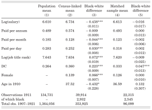
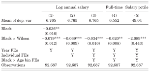

---
# A three-hour workshop deck covering the textbook's sections 11.1 and 11.3
# (lesson/targets.qmd) and chapter 12 (lesson/ai.qmd).
#
# Render with `quarto render index.qmd` from this folder. Almost every slide is
# an animated diagram: a function in typst/*.typ that redraws the picture for
# each subslide, called as `#slide(repeat: n, self => anim-x(self.subslide))`.
# Add `handout: true` below for a PDF with one page per slide (the last frame).
title: "AIによる研究パイプライン"
subtitle: "{targets} と Quarto で, 確かめながら進める"
brand:
  typography:
    fonts:
      - family: Noto Sans JP
        source: system
      - family: Fira Code
        source: system
    base:
      family: Noto Sans JP
    headings:
      family: Noto Sans JP
    monospace:
      family: Fira Code
format:
  touying-typst:
    include-in-header:
      text: |
        #import "@preview/touying-quarto-clean:0.2.0": *
        #import "typst/lib.typ": *
        #import "typst/intro.typ": *
        #import "typst/targets.typ": *
        #import "typst/quarto.typ": *
        #import "typst/reading.typ": *
        #import "typst/workflow.typ": *
        #import "typst/cleanroom.typ": *
        // Numbers measured by R (written by the `values` chunk below).
        #let deck-values = json("output/values.json")
        #let q = deck-values.q
        #let ax = deck-values.ax
        #let deck-theme = clean-theme.with(
          font-family-heading: brand-font-heading,
          font-family-body: brand-font-body,
          font-weight-heading: "medium",
          font-weight-body: "regular",
          font-weight-title: "medium",
          font-weight-subtitle: "regular",
          config-common(new-section-slide-fn: deck-section-slide),
        )
    theme-typst: deck-theme
environments:
  exercise: exercise
  prompt: prompt-card
author:
  - name: 柳本和春
    orcid: 0009-0007-1967-8304
    email: yanagimoto@econ.kobe-u.ac.jp
    affiliations: 神戸大学
date: today
date-format: long
---

```{r}
#| label: setup
#| include: false
# Self-contained: source this deck's frozen setup, never tar_load() a pipeline.
source("code/setup.R")
theme_set(theme_slide())
```

```{r}
#| label: values
#| include: false
# Hand the measured numbers to the Typst diagrams through a file, so that no
# result is typed into a figure by hand. The header of this deck reads
# output/values.json: `q` holds the Quarto + targets example, `ax` the
# replication of Aneja and Xu (2022).
q_row <- function(name) {
  r <- quarto_example |> filter(scenario == name)
  list(
    completed = as.character(r$completed),
    skipped = as.character(r$skipped),
    est = sprintf("%.2f", r$estimate)
  )
}
values <- list(
  q = list(
    base = q_row("base"),
    theme = q_row("theme"),
    event = q_row("event"),
    clean = q_row("clean")
  ),
  ax = list(
    n_matched = fmt_int(sample_sizes$n_matched),
    n_singletons = fmt_int(sample_sizes$n_singletons),
    n_estimation = fmt_int(sample_sizes$n_estimation),
    did3 = fmt_num(did3$estimate),
    did3_se = fmt_num(did3$std_error),
    did3_pub = fmt_num(did3$published_estimate),
    tab3_col2 = fmt_num(published_tab3_col2$estimate),
    tab3_col2_se = fmt_num(published_tab3_col2$std_error),
    bd_first_last = as.character(bd_first$last_robust),
    bd_first_zero = as.character(bd_first$first_zero),
    bd_avg_zero = as.character(bd_avg$first_zero)
  )
)
dir.create("output", showWarnings = FALSE)
jsonlite::write_json(
  values,
  "output/values.json",
  auto_unbox = TRUE,
  pretty = TRUE
)
```

## AIと研究コスト

```{=typst}
#anim-cost()
```

- AI なら数百行のコードも数分で書けるが, 確かめるコストは変わらない.
- AI が速く書くほど, 確かめる仕事の比重が増していく.

## ツールと検証性

```{=typst}
#anim-four-tools()
```



- AI時代は, 検証のしやすさをツールとワークフローで整備する必要がある
- Git, Zotero, Quarto については[レクチャーノート](https://kazuyanagimoto.com/workshop-graduate-2026/)を参照

# `{targets}` の基本

## スクリプトを順に実行するやり方は, 変更に弱い

```{=typst}
#slide(repeat: 3, self => anim-scripts(self.subslide))
```

## パイプラインを構成する3つの要素

```{=typst}
#anim-elements()
```

- ファイルを読んでオブジェクトを作り, 関数に通して次のオブジェクトを作る.

## パイプライン

```{=typst}
#slide(repeat: 5, self => anim-build(self.subslide))
```

## パイプラインの実行

```{=typst}
#slide(repeat: 6, self => anim-make(self.subslide))
```

## 演習1: パイプラインを組む

:::: {.exercise options="num: 1, time: 10"}

[11.1 節](https://kazuyanagimoto.com/workshop-graduate-2026/lesson/targets.html) のコードで, 種ごとのくちばしの平均長を計算せよ.




1. 空のフォルダに, R ファイル2つと生データの CSV を用意する.
1. 実行前のグラフを見てから計算し, もう一度グラフを見る.
1. `penguins_summary` を読み出し, 結果を確かめる.

   ```r
   targets::tar_visnetwork()
   targets::tar_make()
   targets::tar_read(penguins_summary)
   ```

::::

## 演習2: パイプラインと変更 {#sec-exr-2}

:::: {.exercise options="num: 2, time: 10"}

次の変更を入れた時の各挙動を `tar_visnetwork()` や `tar_make()` で確かめよ.



1. `clean_penguins()` で, 体重が欠損した個体も除く.

   ```r
   filter(!is.na(bill_len), !is.na(body_mass))
   ```

1. R コンソールで, 2008 年以降の生データを CSV に上書きする.

   ```r
   write.csv(subset(penguins, year >= 2008),
             "data/penguins.csv", row.names = FALSE)
   ```

[[解説]{.button}](#sec-ans-2_1)

::::


## 覚えておくべき4つのコマンド

```{=typst}
#fig-commands()
```

# Quarto + `{targets}`

## Quarto とパイプライン

```{=typst}
#anim-qpipe-overview()
```

- `tar_data` でデータを整え, `tar_analysis` で集計・推定する.
- `tar_manuscript` で原稿を PDF にし, `_targets.R` で3つを束ねる.

## Quarto と図表

```{=typst}
#anim-compute-render()
```

- Quarto では, `tar_load()` で読み込んだオブジェクトから図や表を作ることを推奨

## オブジェクトと読み込み

```{=typst}
#slide(repeat: 4, self => anim-manuscript(self.subslide, q))
```

## `tar_quarto()` による依存関係の自動生成

```{=typst}
#anim-tar-quarto()
```

- `main.qmd` の変更も, 読み込んでいるオブジェクトの変更も自動で追跡される

## インラインコード

```{=typst}
#slide(repeat: 2, self => anim-inline(self.subslide, q))
```


## 演習3: Quarto + `{targets}` で PDF を作る {#sec-exr-3}

:::: {.exercise options="num: 3, time: 15"}

[教材 ZIP](https://kazuyanagimoto.com/workshop-graduate-2026/static/data/targets-quarto.zip) を展開し, `targets::tar_make()` で PDF を作ってください.
次を順に試し, 毎回, 再計算の個数を予想してから実行します.



1. `manuscript/main.qmd` のテーマを `theme_minimal` にする.
1. `R/tar_analysis.R` の `estimate_event()` の式から `x1` を外す.
1. `R/tar_data.R` の `clean_did()` の末尾に, 次の条件を足す.

   ```r
   |> filter(abs(x1) < 8)
   ```

[[解説]{.button}](#sec-ans-3)

::::

# AIと論文を読む

## 人種分離は黒人公務員の賃金をどう変えたか [[@aneja2022]]{.small-cite}



{width="50%" fig-align="center"}

- 1913 年に発足した Wilson 政権が, 連邦政府の公務員を人種で分離した
- 1907-21 年の職員名簿をデジタル化し, 1910 年の国勢調査と接続して人種を特定
- 黒人と白人の賃金差が, 政権交代の前後でどう変わったかを推定


## AI + Zotero MCP

```{=typst}
#anim-zotero()
```



1. **検索**: DOIを出力させ, Zoteroに取り込みやすくする
1. **精読**: 根拠のページを出力しながら要約させることで, 原文を確かめやすくする

## 演習4: Literature Review {#sec-exr-4}

:::: {.exercise options="num: 4, time: 8"}

Aneja と Xu となったつもりで, 文献レビューを AI に頼む指示を2つ書け.



1. **検索**: この研究が貢献しうる文献の流れを整理させる.
    - 3つの流れを挙げ, 代表的な論文を5本ずつ DOI 付きで挙げさせる.
    - 各流れで何が分かっていて, 何が分かっていないかをまとめさせる.
1. **精読**: 各論文を全文で読ませ, 正確な要約を作らせる.
    - Zotero にコレクションを一つ作り, 上であげた論文を全て入れる.
    - Zotero MCPを使い, 各論文が何を問い, どのデータと識別戦略で, 何を示したかを2, 3文でまとめさせる. 根拠のページ番号も出力させる.

[[プロンプト例]{.button}](#sec-ans-4)

::::

# 研究のワークフロー

## 試行錯誤とフィードバック

```{=typst}
#fig-research-loop()
```

- 研究は試行錯誤とフィードバックの繰り返しを通じて進む
- 研究が進むにつれて, 研究の目的や手法が変わることもある

## 試行錯誤と本番環境の切り分け

```{=typst}
#fig-workflow-folders()
```



- ノートと発表資料はその時点の記録として残し, 論文は最新の分析で更新する
- `notes/` や `slides/` は論文環境に依存させないのがポイント
- [kazuyanagimoto/template-research](https://github.com/kazuyanagimoto/template-research) としてテンプレートになっている

## `notes/` の構成

```{=typst}
#fig-notes-folders()
```



各ノートは独立したプロジェクトで, コードやデータが独立している:

- クリーニングのコードすらも他のノートと共有しない
- データの重複はコストが高いので, シンボリックリンクで共有する

## `01-descriptive`: 黒人と白人の賃金分布とマッチング



::: {layout-ncol=2}




:::

- 黒人の賃金は, 分布全体で低い. 多くの黒人と白人の賃金が重ならない
- 性別, 部局, 契約の形態, 賃金, 年齢が近い黒人と白人をマッチング (CEM) する根拠


## 演習 5: 記述統計

:::: {.exercise options="num: 5, time: 10"}

`notes/01-descriptive/` で, @aneja2022 の Table I と Figure I を再現する指示を書いてください.



- [kazuyanagimoto/template-research](https://github.com/kazuyanagimoto/template-research) を使いレポジトリを作成, クローンする
- [Replication package](https://doi.org/10.7910/DVN/SNQLEI)
- Zotero MCP を使い, Table I, Figure I のサンプルを確認する
- データはすでにマッチング済みであることを踏まえて作成する
- Replication package のコードは決して読まないこと
    - 論文の中に書いてある記述だけで指示を書くこと
    - これはあくまで, Aneja と Xu の立場でAIに分析させる練習です

::::

## 演習 6: DID推定

:::: {.exercise options="num: 6, time: 10"}

`notes/02-did/` で, Table II と Figure II を再現する指示を書いてください.

::: {layout-ncol=2}

{width="58%"}

{width="40%"}

:::

- サンプル, ウェイト, 標準誤差, 基準年を確かめてから指示を書くこと

::::

## `slides/` の構成

```{=typst}
#fig-slides-folders()
```

- ノートの結果を `output/` にコピーし, 発表時の内容を固定する
- `notes/` と同じように, 完全に独立した `code/` や `data/` を持つのもよい
    - 私は SMM など長時間推定を含む場合は, `output/` のコピーで済ませる

## 演習 7: 発表資料

:::: {.exercise options="num: 7, time: 10"}

`01-descriptive` と `02-did` の結果を使い, 発表資料のスライドを作る指示を書け



- `slides/261015_seminar/` 以下にスライド用の環境を作る
- Quartoでやる場合は, [`quarto-touying-typst`](https://github.com/kazuyanagimoto/quarto-touying-typst) がおすすめ
- Beamer など慣れた方法でもよい

::::

## プレゼンのフィードバック {#sec-feedback}

```{=typst}
#fig-feedback()
```

- `03-placebo`, `04-mechanism` は論文で回答している [[03-placebo]{.button}](#sec-placebo) [[04-mechanism]{.button}](#sec-mechanism)
- `05-honestdid` は @rambachan2023 以降, 重要な指摘

## `05-honestdid`: 平行トレンドの崩れ方に上限を置く

```{=typst}
#slide(repeat: 3, self => anim-rm(self.subslide))
```

```{r}
#| label: frames-honestdid
#| include: false
# Four frames of the same figure: the original interval, then the robust
# intervals up to Mbar = 0, up to the last Mbar that still excludes zero for
# the effect in 1913, and all of them.
save_frame(plot_honestdid(-Inf), "honestdid-1")
save_frame(plot_honestdid(0), "honestdid-2")
save_frame(plot_honestdid(bd_first$last_robust), "honestdid-3")
save_frame(plot_honestdid(Inf), "honestdid-4")
```

## Honest DID [[@rambachan2023]]{.small-cite}

```{=typst}
#slide(repeat: 4, self => anim-honestdid(self.subslide, ax))
```

## `R/` と `manuscript/` の構成

```{=typst}
#fig-production-folders()
```

- ノートは記録として残し, 固まった分析だけを `R/tar_analysis.R` に移す
- 原稿は結果を読み込み, `R/tar_manuscript.R` が PDF を更新する

## 演習 8: 論文を書く {#sec-exr-8}

:::: {.exercise options="num: 8, time: 30"}

`R/` でパイプラインを構成し, `manuscript/` で論文を作る指示を書け



1. `tar_analysis.R` に `notes/` のコードを移す
1. `02-analysis.qmd` で, `tar_load()` したオブジェクトから図や表を作る
1. 結果の解釈をインラインコードで埋め込み, 本文に書く
1. `tar_make()` でPDFがコンパイルされることを確認する



余力があれば:

- `01-intro.qmd` に Literature Review を書く
- `03-placebo`, `04-mechanism`, `05-honestdid` の結果を追加する

::::

# AIで結果を検証する

## クリーンルーム設計

```{=typst}
#slide(repeat: 3, self => anim-software-cleanroom(self.subslide))
```

## 再現性: 論文の記述とデータだけで結果を作れるか

```{=typst}
#slide(repeat: 3, self => anim-repro(self.subslide))
```

## クリーンルームワークフロー

```{=typst}
#slide(repeat: 5, self => anim-cleanroom(self.subslide))
```

## Step 1: 数値を ID に置き換える

```{=typst}
#fig-mask(ax)
```

- 数値がすべてインラインコードなら, スクリプトで機械的に置き換えられる

## Step 1: ダミーデータを作る

```{=typst}
#fig-dummy-data()
```

- 元データを見せると, 論文ではなくデータに合わせたコードを書くおそれがある
- 列の名前と型だけを揃えて値は独立に生成し, コードが動くかを確かめる

## Step 2: コードの実装

```{=typst}
#slide(repeat: 2, self => anim-replicator(self.subslide))
```

## Step 3: 不一致を仕分ける

```{=typst}
#fig-triage()
```



- 元のコードの誤りや論文の記述の不正確さを見つけることができる
- 再現側に値やずれの方向を伝えると, 再現する側はその値に合わせにいく. あくまでも再現者自身でコードの誤りを見つけさせるのが重要

# まとめ

## AIによる研究パイプライン

```{=typst}
#fig-summary()
```

[テンプレート: [kazuyanagimoto/template-research](https://github.com/kazuyanagimoto/template-research). レクチャーノート: [Empiricist's Workflow](https://kazuyanagimoto.com/workshop-graduate-2026/).]{.small-cite}



# Appendix

## 2.1. 関数を変更した場合 {#sec-ans-2_1}

```{=typst}
#slide(repeat: 6, self => anim-fn-change(self.subslide))
```

## 2.2. データを変更した場合 {#sec-ans-2_2}

```{=typst}
#slide(repeat: 5, self => anim-data-change(self.subslide))
```

## 3. Quarto と `{targets}` {#sec-ans-3}

```{=typst}
#slide(repeat: 6, self => anim-what-reruns(self.subslide, q))
```

## 4. Literature Review {#sec-ans-4}

::: {.prompt}
Wilson 政権による公務員の人種分離が, 黒人公務員の賃金に与えた影響を調べたい. この研究が貢献しうる経済学の文献の流れを3つ挙げて. それぞれについて代表的な論文を5本ずつ, [著者, 年, 雑誌, DOI 付き]{.alert} で挙げること. 対象は査読付き論文と, NBER などのワーキングペーパーに限る. 各流れで [何が分かっていて, 何が分かっていないか]{.alert} も, 1段落ずつまとめて.
:::

::: {.prompt}
Zotero の `wilson-segregation` コレクションにある論文を [全文で読んで]{.alert}, さっきの3つの流れに分類して. 各論文が何を問い, どのデータと識別戦略で, 何を示したかを2, 3文でまとめ, [根拠のページ番号]{.alert} を付けて. 最初の整理と食い違う点があれば, [全文の方を正として]{.alert} 直すこと. 最後に, 3つの流れのどれもが答えていない問いのうち, この研究で答えられるものを挙げて.
:::

[[Back to main]{.button}](#sec-exr-4)

## `03-placebo`: 政権交代一般の効果か, Wilson の政策の効果か {#sec-placebo}



{width="50%" fig-align="center"}

- 人種分離の政策を伴わない McKinley から Roosevelt への政権交代と比べる
- 有意な賃金差が見えないので, 1913 年以降の変化は Wilson の政策と示唆

[[Back to main]{.button}](#sec-feedback)

## `04-mechanism`: 賃金差の多くは, 職の移動で生じた {#sec-mechanism}

```{=typst}
#slide(repeat: 4, self => anim-mechanism(self.subslide, ax))
```

## 参考文献

```{=typst}
// Rambachan and Roth (2023) is named only inside a diagram, so register it
// with the bibliography here.
#cite(<rambachan2023>, form: none)
```

::: {#refs}
:::

[Git logo by Jason Long, [CC BY 3.0](https://creativecommons.org/licenses/by/3.0/). ロゴの出典: [Git](https://git-scm.com/community/logos), [Zotero](https://www.zotero.org/support/brand), [Quarto](https://github.com/quarto-dev/quarto-web/blob/main/quarto-icon.svg), [targets](https://github.com/ropensci/targets/blob/main/man/figures/logo.png).]{.small-cite}
